# Apartment Management System

A web-based apartment management system built with Spring Boot. It covers the full lifecycle of apartment management — from tenant onboarding and lease contracts, to monthly utility invoicing, payment tracking, maintenance tickets, and building announcements.

## Features

- **Tenant Management** — Register tenants, store contact details and ID information, view full tenant profiles
- **Room Management** — Track rooms by floor, base rent, and occupancy status (Vacant / Occupied / Maintenance)
- **Lease Contracts** — Create and manage fixed-term lease contracts with custom monthly rent per tenant
- **Utility Billing** — Record monthly electricity and water meter readings; set per-unit rates; auto-calculate usage charges
- **Invoice Generation** — Generate monthly invoices (rent + utilities) per contract; reprint or export as PDF
- **Payment Recording** — Record tenant payments; auto-apply payments to oldest outstanding invoices; handle overpayments as credit balance
- **Payment Receipts** — Print or export payment receipts as PDF
- **Maintenance Tickets** — Tenants submit tickets with description and photo evidence; managers assign technicians to fix the issues
- **Building Announcements** — Post news and rule announcements visible to all tenants
- **Tenant Portal** — Tenants have a dedicated self-service view for their own contracts, invoices, payments, tickets, and announcements
- **Role-Based Access Control** — Separate permission levels for Landlord, Manager, Accountant, Technician, and Tenant

---

### Demo Logins

| Username | Password | Role | Access |
|---|---|---|---|
| `landlord` | `password` | Landlord | Full access — rooms, tenants, contracts, invoices, payments, announcements, tickets |
| `manager` | `password` | Manager | Rooms, tenants, contracts, maintenance tickets |
| `accountant` | `password` | Accountant | Invoices, payments, utility rates & meter readings |
| `technician` | `password` | Technician | View & update assigned maintenance tickets |
| `tenant1`–`tenant20` | `password` | Tenant | Personal portal — own contract, invoices, payments, tickets, announcements |

## Demo Screenshots

### Tenants
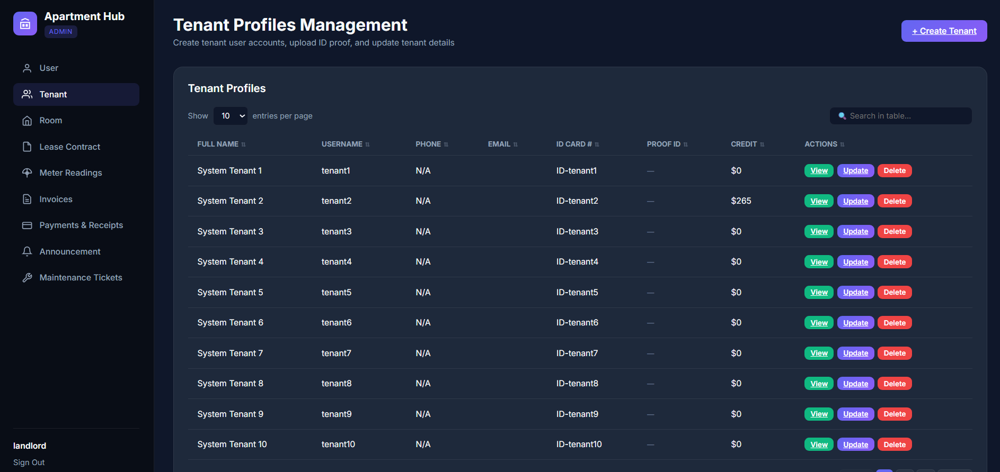

### Rooms
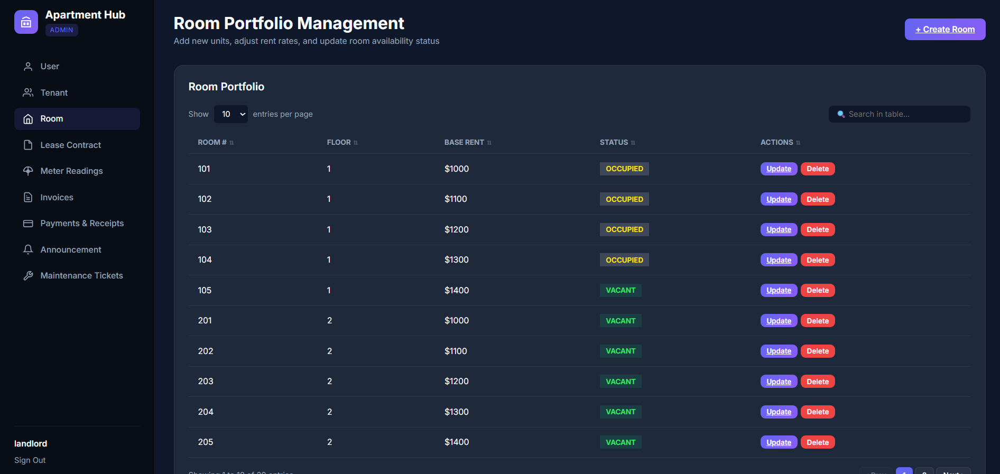

### Lease Contracts
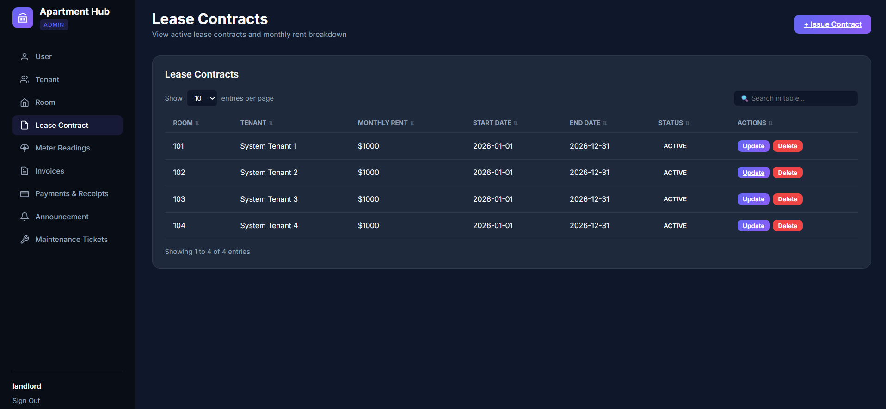

### Invoices
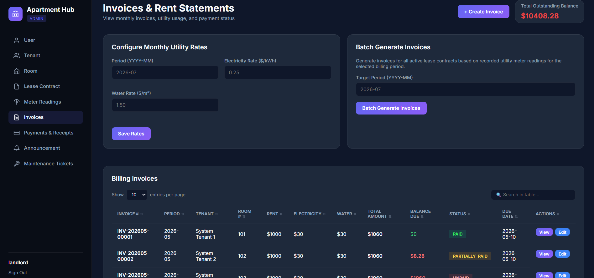
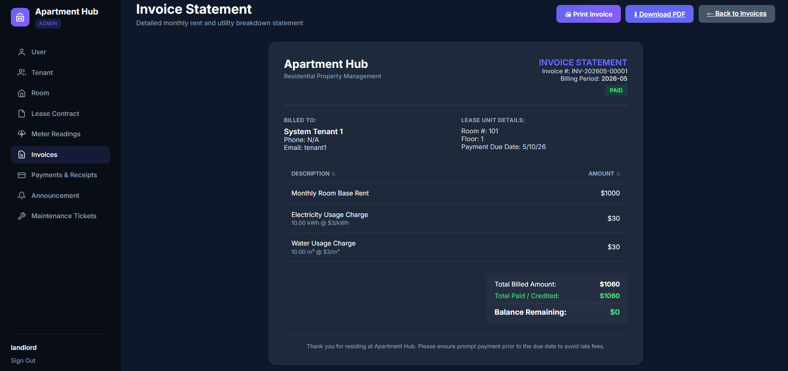
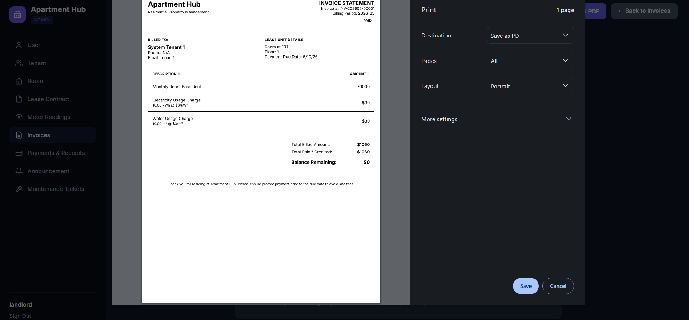

### Payments
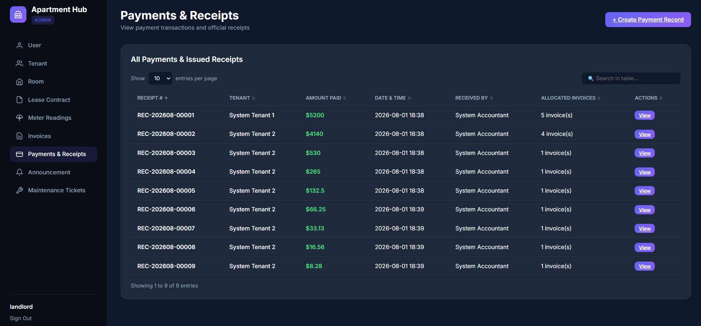
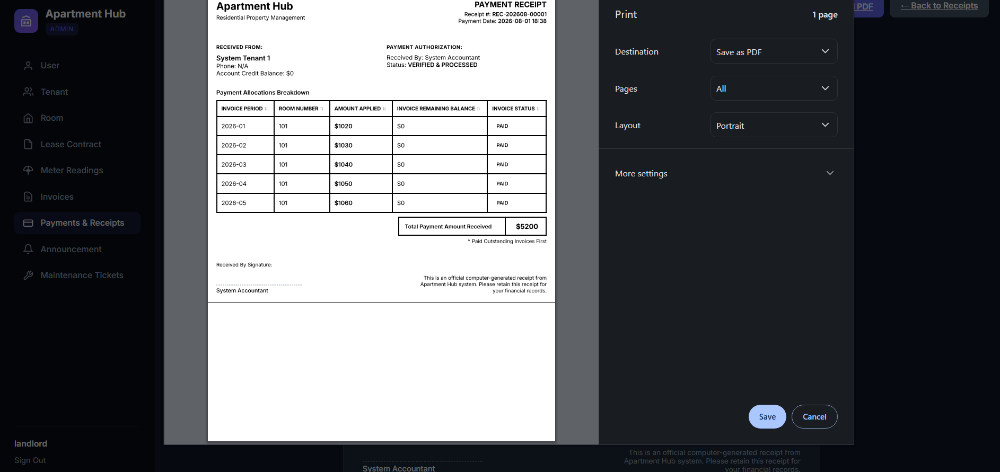

### Announcements
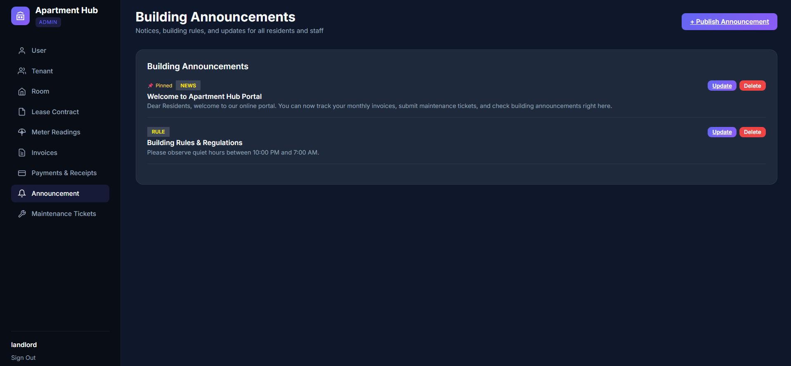

### Maintenance Tickets
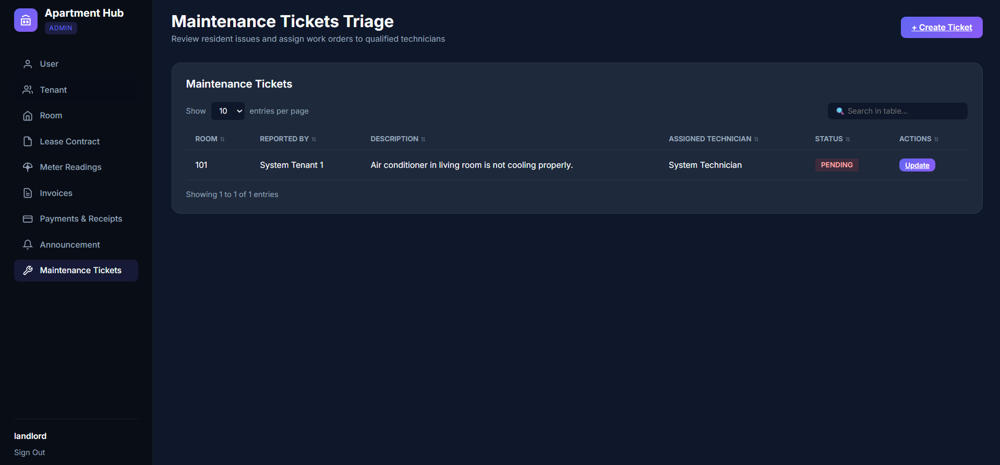
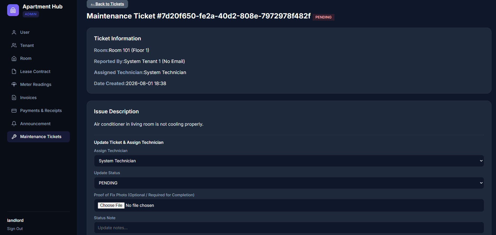
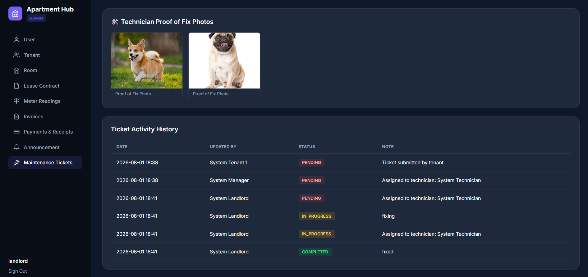

---

### Core Workflows

1. **Onboard a Tenant** — Create a user with the Tenant role, then create a Tenant profile linked to that user.
2. **Create a Lease Contract** — Assign a tenant to a room with a monthly rent and contract period.
3. **Record Meter Readings** — Enter electricity and water readings for each room each month.
4. **Generate Invoices** — Generate monthly invoices per contract; the system calculates rent + utility costs automatically.
5. **Record Payments** — Payments are applied against outstanding invoices oldest-first; overpayments are stored as credit.
6. **Print Documents** — Invoices and payment receipts can be printed or exported as PDF.
7. **Maintenance Tickets** — Tenants submit maintenance requests with optional photos; managers assign technicians.
8. **Announcements** — Landlords and managers post announcements visible to all tenants.

---

## Tech Stack

| Layer | Technology |
|---|---|
| Language | Java 25 |
| Framework | Spring Boot 4.1.0 |
| Persistence | Spring Data JPA / Hibernate 7 |
| Database | SQLite (via `sqlite-jdbc` + `hibernate-community-dialects`) |
| Web | Spring MVC + Thymeleaf |
| Security | Spring Security 6 |
| PDF Export | OpenPDF (LibrePDF) |
| Build | Maven (Maven Wrapper) |
| Dev Tools | Spring Boot DevTools (hot reload) |
| Utilities | Lombok |

---

## Development Setup

### Prerequisites

- Java 25+
- Maven (or use the included `./mvnw` wrapper)

### Run

```sh
# Fresh start (clears the SQLite database)
rm -rf ./data && ./dev.sh

# Or just run (keeps existing data)
./dev.sh
```

The app starts at **http://localhost:8080**

### Database Inspector (H2 Console)

Access the H2 Console at **http://localhost:8080/h2-console** with:

| Field | Value |
|---|---|
| Driver Class | `org.sqlite.JDBC` |
| JDBC URL | `jdbc:sqlite:./data/ams.db` |
| User Name | *(leave empty)* |
| Password | *(leave empty)* |

### Project Structure

```
src/main/java/com/dreamoutbox/ams/
├── config/          # Security config, data seeding
├── contract/        # Lease contract management
├── finance/         # Invoices, payments, utility rates, meter readings
├── maintenance/     # Maintenance tickets
├── announcement/    # Building announcements
├── room/            # Room management
├── tenant/          # Tenant profiles
├── user/            # User accounts & roles
└── web/             # MVC controllers (Thymeleaf views)

src/main/resources/
├── templates/       # Thymeleaf HTML templates
└── static/          # CSS, JS, images
```
